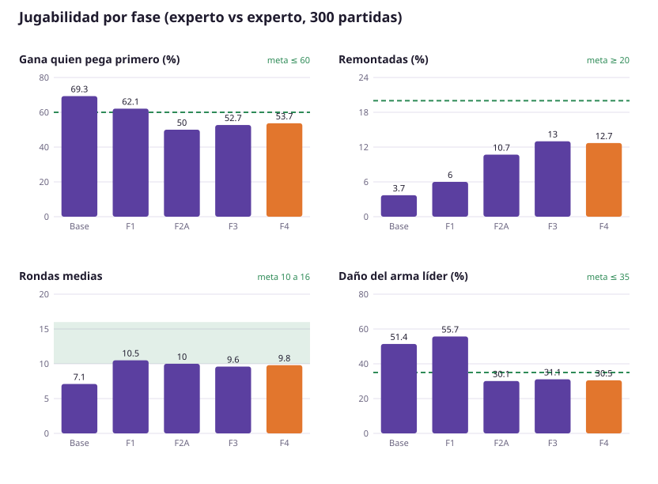

# Resumen de jugabilidad: línea base y las cuatro fases

Objetivo: pasar de un combate donde "el que pega primero gana" a uno que obligue a decidir posición, arma, viento, terreno y eventos. Todo se mide con el bot de simulación (`docs/BOT.md`), 300 partidas con semillas fijas por emparejamiento; las cifras de abajo son **experto contra experto**.

## Tabla de métricas

| Métrica | Meta | Base | Fase 1 | Fase 2A | Fase 3 | Fase 4 (final) | ¿Cumple? |
|---|---|---|---|---|---|---|---|
| Gana quien da el primer golpe | ≤ 60 % | 69.3 % | 62.1 % | 50.0 % | 52.7 % | **53.7 %** | Sí |
| Empates | ≤ 5 % | 3.0 % | 0.3 % | 0.7 % | 1.3 % | **0.0 %** | Sí |
| Rondas medias | 10 a 16 | 7.1 | 10.5 | 10.0 | 9.6 | **9.8** | Casi (0.2 por debajo) |
| Remontadas (ganó quien llegó a ≤ 40 % de la vida del rival) | ≥ 20 % | 3.7 % | 6.0 % | 10.7 % | 13.0 % | **12.7 %** | **No** |
| Mayor cuota de daño de un arma | ≤ 35 % | 51.4 % (Bazuca) | 55.7 % (Bazuca) | 30.1 % (Bazuca) | 31.1 % (Bazuca) | **30.5 % (Bazuca)** | Sí |
| Arma más elegida | ≤ 40 % | 32.5 % | 28.8 % | 27.9 % | 25.9 % | **21.5 %** | Sí |

Otros emparejamientos de la versión final (300 partidas): novato contra novato, primer golpe 51.9 %, empates 0.7 %, 10.7 rondas, 25.8 % de turnos con acierto; experto contra novato, primer golpe 52.5 %, 10.1 rondas, 39.9 % de acierto. La base daba 70.8 % y 86.3 % de primer golpe respectivamente.

## Qué movió cada fase

| Fase | Cambio principal | Efecto medido |
|---|---|---|
| 0 | Bot novato/experto, simulador y línea base | Primer golpe 69.3 %: el problema era real |
| 1 | Viento por turno y ráfagas, puntería neutra, dispersión por arma, empuje, cobertura, ácido letal; daño a la mitad | Primer golpe 69.3 → 62.1 %, rondas 7.1 → 10.5. La dispersión sola casi no movía el primer golpe; lo que sí lo bajó fue alargar la partida |
| 2A | 8 armas con munición, Cañón infinito, mortero, poción, aturdir, Tesla en cadena | Primer golpe → 50.0 %, Bazuca 55.7 → 30.1 %, remontadas 6.0 → 10.7 % |
| 3 | Obstáculos, peligros por mapa y eventos de ronda con aviso | Remontadas → 13.0 %; los peligros acortaban la partida y hubo que suavizar grúa y pelota |
| 4 | Cajas nuevas, ayuda al que va perdiendo, cofre de remiendos | Remontadas se quedan en ≈ 13 % (11 a 16 % según variante) |

## Lo que no se logró y qué probaría

1. **Remontadas 12.7 % frente a 20 %.** Cajas, ayuda al rezagado y un bono de daño no pasaron de 16 %, dentro del ruido de 300 partidas. Cuando alguien baja al 40 % de la vida del rival ya quedan pocos turnos y el ácido cierra la partida. Ajustes que probaría: (a) partidas más largas (más vida base o ácido más tardío, que hoy sigue el HANDOFF), (b) que el bot experto use barriles, resortes y portales, (c) una segunda oportunidad explícita al caer bajo un umbral.
2. **Rondas medias 9.8 (meta 10 a 16).** El ácido de la ronda 6 limita el techo. El mismo ajuste (a) lo arregla.
3. **Mazo y Rayo Tesla casi no se usan.** El bot solo los elige cuando ya están al alcance y no se acerca a propósito; los jugadores humanos sí los usarán. Se anotó como mejora del bot.
4. **Medida solo con el bot.** El bot no representa a una persona: falta una sesión de pruebas con jugadores y el 60 fps en un equipo con GPU (el entorno de pruebas usa WebGL por software).

## Qué quedó entregado

- Núcleo (`src/core/`): `bot.ts`, `sim.ts`, `aim.ts`, `tuning.ts`, `world.ts`, `rewards.ts`; datos nuevos `tuning.json`, `events.json`, `cosmetics.json`, `maps.json → hazards`, `weapons.json` ampliado, `crates.json` ampliado.
- Pruebas nuevas: `bot`, `phase1`, `weapons2`, `world`, `crates4`, `rewards`; en total `npm test` pasa 426 (con las pruebas de otras tareas).
- UI: carrusel de armas con munición, banners de eventos y avisos, dibujo de obstáculos y peligros, charcos de ácido, pantalla Colección y cofre en el resumen.
- e2e Playwright en PC (1600×900) y móvil (844×390): partida completa, mapas y capturas de jugabilidad.
- Capturas en `docs/capturas/jugabilidad/`: las 8 armas, un mapa vivo por cada uno de los 3 mapas, un evento con su aviso, el cofre del resumen y la colección.
- Documentos: `BALANCE_BASE`, `BALANCE_FASE1` a `BALANCE_FASE4`, `BOT`, `../DECISIONES_JUEGO.md` y el diseño del modo escuadra en `../futuro/ESCUADRA.md`.

Para repetir las mediciones: `SIM_N=300 SIM_OUT=docs/balance/BALANCE_FASE4.md npm run simulate` y, para redibujar la gráfica, `node scripts/chart-balance.mjs`.
